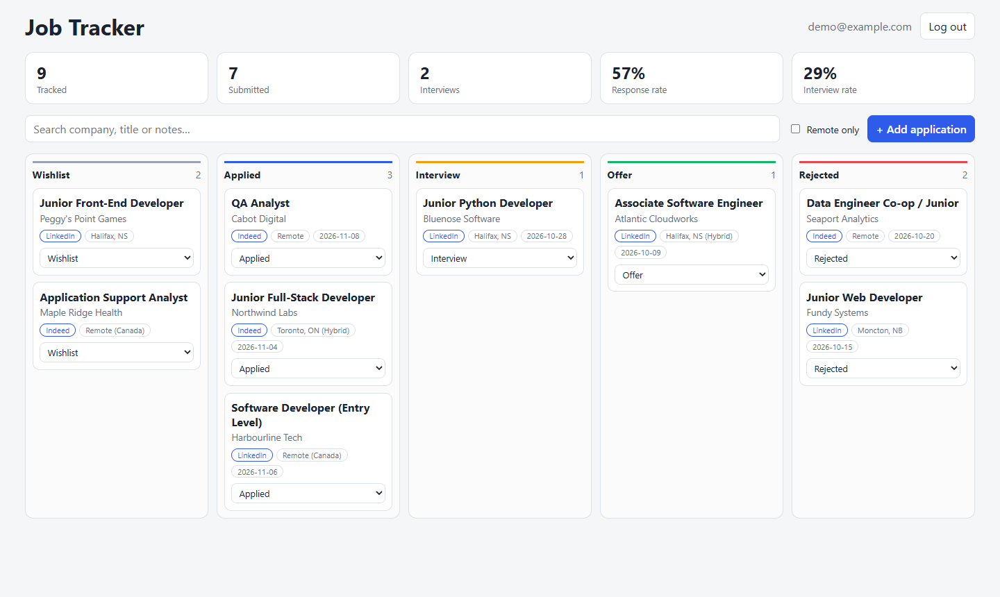

# Job Tracker

A full-stack system for tracking a job search: a React dashboard, a FastAPI backend, and a Chrome extension that captures jobs from LinkedIn and Indeed and logs applications automatically. Built to manage my own job search.

**Stack:** Python · FastAPI · SQLAlchemy · SQLite · JWT auth · React (Vite) · Chrome Extension (Manifest V3) · pytest · node:test

<!-- Add a screenshot here:  -->

```
 LinkedIn / Indeed page ──► content script ──► extension service worker ──► FastAPI ──► SQLite
                                                (retry queue if offline)        ▲
                                         React dashboard (board, stats) ────────┘
```

## Features

**Dashboard**
- Sign up / log in (passwords hashed with scrypt, stateless JWT sessions)
- Kanban board: drag a card between columns, or use the status dropdown on the card
- Add, edit and delete applications (company, title, location, remote flag, posting URL, pay note, notes, date applied)
- Search across company / title / notes, and filter to remote-only
- Summary stats: applications submitted, interviews, response rate, interview rate
- Each user only ever sees their own data (covered by tests)

**Browser extension**
- **One-click save:** on any job page, the popup pre-fills title, company, location and remote from the page; fix anything, then *Save to Wishlist* or *I applied today*
- **Automatic logging on LinkedIn:** when Easy Apply shows "Your application was sent", the job is saved as Applied with today's date
- **Automatic logging on Indeed:** clicking *Apply* saves the job to Wishlist; when Indeed's apply flow confirms submission, it moves to Applied
- **No duplicates:** the same posting reached through search results, emails or share links is recognised as one job
- **Never loses a save:** if the backend isn't running or you're logged out, saves are queued (badge count on the icon) and synced later
- Works on any other site too: the popup falls back to the tab's title and URL

## Run it locally

You need Python 3.11+ and Node 20+.

```powershell
# 1. API (terminal 1)
cd backend
python -m venv .venv
.venv\Scripts\activate                     # macOS/Linux: source .venv/bin/activate
pip install -r requirements-dev.txt
$env:SECRET_KEY = "change-me"              # macOS/Linux: export SECRET_KEY=change-me
uvicorn app.main:app --reload --reload-dir app   # http://localhost:8000/docs

# 2. Front end (terminal 2)
cd frontend
npm install
npm run dev                                # http://localhost:5173
```

The Vite dev server proxies `/api` to port 8000, so there is nothing else to configure.

### Install the extension

1. Open `chrome://extensions` (or `edge://extensions`) and turn on **Developer mode**.
2. Click **Load unpacked** and pick the `extension/` folder.
3. Pin **Job Tracker Capture**, click it, and log in with your tracker account.
4. Refresh any LinkedIn or Indeed tabs that were already open.

The extension calls `http://localhost:8000` by default. If you deploy the API, change the URL under **Settings** in the popup; Chrome will ask for permission to reach the new host.

### Tests

```powershell
cd backend; pytest                              # API: auth, CRUD, ownership, capture/dedupe, schema upgrade
node --test extension/test/parsers.test.js      # extension: URL canonicalisation and page parsing
```

## API

| Method | Path | Description |
| --- | --- | --- |
| POST | `/api/auth/register` | Create an account |
| POST | `/api/auth/token` | Log in (OAuth2 password form), returns a JWT |
| GET | `/api/auth/me` | Current user |
| GET | `/api/applications?status=&q=&remote=` | List/filter your applications |
| POST | `/api/applications` | Create |
| GET / PATCH / DELETE | `/api/applications/{id}` | Read / partially update / delete |
| GET | `/api/applications/stats` | Counts per status and conversion rates |
| POST | `/api/applications/capture` | Create-or-update by URL (used by the extension) |
| GET | `/api/applications/lookup?url=` | Is this posting already tracked? |

## Design notes

- **Capture is idempotent.** The extension may send the same job several times (a retry, a page re-render). `capture` matches on a normalised URL, only ever moves status *forward* (it won't undo an Interview), fills in blank fields, and never overwrites a company or title you edited by hand.
- **URLs are canonicalised twice.** The extension turns site-specific URLs into one form (`linkedin.com/jobs/view/<id>`, `indeed.com/viewjob?jk=<key>`); the API also strips tracking parameters (`utm_*`, `trk`, …) and fragments, so manual entries match captured ones.
- **No CORS changes for the extension.** Requests go through the extension's service worker, and hosts in `host_permissions` aren't subject to CORS.
- **Site scrapers degrade gracefully.** LinkedIn and Indeed change their markup often, so each field has several selectors and falls back to parsing the page title, and the popup always lets you correct the result. The extension only reads the page you have open after you act; it doesn't crawl.
- **Offline-first saves.** Failed captures go into `chrome.storage` and are retried on the next successful save, on login, on browser start, or from the popup.
- **Ownership checks return 404, not 403**, so one user can't probe which IDs exist for another. **Login errors are identical** for an unknown email and a wrong password.
- **PATCH uses `exclude_unset`**, so the UI can send just `{status}` when a card is dragged, while an explicit `null` still clears optional fields.
- **Lightweight schema upgrades.** `ensure_schema()` adds columns introduced after v1 to existing SQLite databases; swap in Alembic if the schema keeps growing.

## Configuration

| Variable | Default | Purpose |
| --- | --- | --- |
| `SECRET_KEY` | random per start | Signs JWTs. **Set this in production.** |
| `DATABASE_URL` | `sqlite:///./jobtracker.db` | Any SQLAlchemy URL |
| `CORS_ORIGINS` | `http://localhost:5173` | Comma-separated allowed origins if the front end is hosted separately |

## What I'd add next

- Gmail import: read "Thanks for applying" emails to catch applications made on any site
- Confirmation detection for Greenhouse, Lever and Workday application pages
- Follow-up reminders and a calendar view
- Alembic migrations and PostgreSQL in production; refresh tokens
- Front-end tests (Vitest + Testing Library) and CI with GitHub Actions
